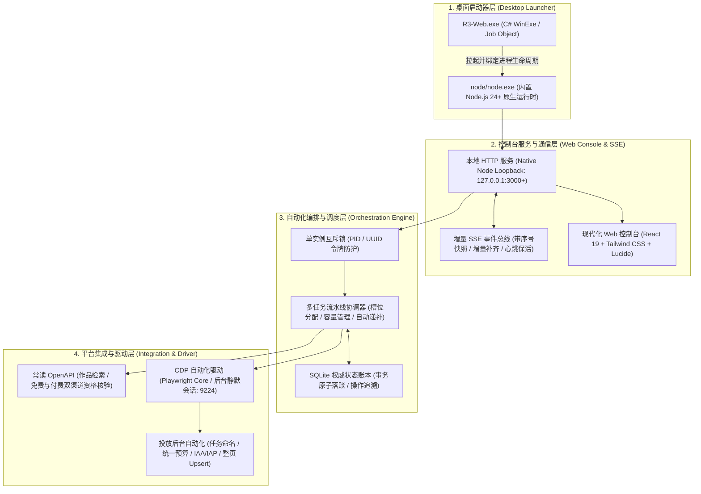
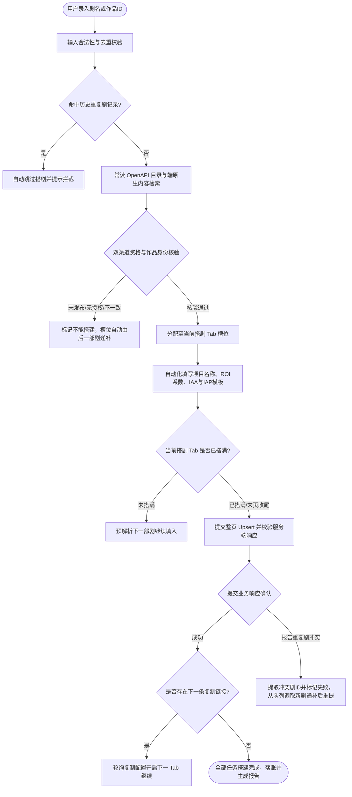

# R3 漫剧自动化搭建系统 (Release Version)

[](LICENSE)
[](README.md)
[](node/node.exe)

R3 是面向短剧与漫剧投流行业打造的企业级一站式自动化搭建系统。系统通过常读端原生 OpenAPI 智能解析作品 ID，严格交叉核验免费与付费双渠道投放资格，并通过 Chrome DevTools Protocol (CDP) 驱动无干扰浏览器会话，自动化完成复制链接解析、搭剧子任务填单、ROI 阶梯系数匹配、IAA 激励视频及 IAP 付费模板的一站式配置与提交。

当前为**正式发布版本（Release Distribution）**，采用开箱即用设计，全套业务逻辑已完成代码加密混淆与依赖压缩，免除复杂的开发环境配置，双击即可直接运行。

---

## 一、系统架构 (Architecture)

### 1.1 系统分层设计

R3 采用微内核、单进程高内聚的分层架构，核心分为启动器层、控制台服务层、自动化编排调度层、平台对接层以及核心数据审计层：



### 1.2 核心业务流程



### 1.3 发布版本目录结构

```
R3-auto/
├── R3-Web.exe                   # 桌面启动器 (双击直接运行控制台)
├── .env.example                 # OpenAPI 凭据配置模板
├── LICENSE                      # 开源许可协议 (MIT)
├── README.md                    # 本文档 (使用说明与架构概述)
├── package.json                 # 生产依赖定义
├── pnpm-lock.yaml               # 依赖锁定清单
├── release-manifest.json        # 发布版本全量文件 SHA-256 指纹校验清单
├── data/                        # 本地运行与配置数据目录 (支持 R3_DATA_DIR 覆盖)
│   ├── drama_list.txt           # 待搭剧目/ID 默认输入源
│   ├── .full_flow_success.json  # 成功标记
│   └── r3_state.sqlite          # SQLite 权威配置源与运行历史账本
├── node/                        # 内置独立运行环境 (免安装 Node)
│   ├── node.exe                 # 随附 Node.js 24 运行引擎
│   └── LICENSE                  # Node.js 许可证
├── node_modules/                # 极简生产依赖包 (playwright-core, xlsx, zod)
├── src/                         # 经过高强度混淆加密的运行时
│   └── web/
│       ├── main.ts              # 核心加密混淆单文件服务入口
│       └── public/              # 编译压缩后的前端 Web 控制台单页资源
│           ├── index.html       # 控制台入口 HTML
│           └── assets/          # 优化构建的 JS Bundle 与 CSS 样式
└── tools/                       # 运维与体积优化工具
    ├── optimize_size.ps1        # Windows 原生 NTFS 透明压缩脚本
    ├── write_release_manifest.ts# 发布清单校验脚本
    └── launcher/WebLauncher.cs  # 桌面启动器 C# 源代码
```

---

## 二、使用说明 (User Guide)

### 2.1 环境要求

- **操作系统**：Windows 10 / Windows 11 (64位)
- **免安装环境**：无需预先安装 Node.js、Python、Git 或构建工具，系统已内置 `node/node.exe` 完整独立运行时。
- **推荐浏览器**：Microsoft Edge 或 Google Chrome（支持远程调试端口）。

### 2.2 快速启动

1. 下载或解压完整的发布包目录。
2. 保持目录结构完整（请勿单独移动 `R3-Web.exe`，它依赖同级 `node/`、`src/` 与 `node_modules/`）。
3. 双击根目录下的 **`R3-Web.exe`**。
4. 程序将自动拉起内置服务并在默认浏览器中打开控制台页面：`http://127.0.0.1:3000`（端口被占用时自动顺延）。
5. 控制台右上角提供服务健康度与运行状态，关闭启动器窗口即可优雅停止后台服务。

### 2.3 OpenAPI 密钥配置

首次使用前，请在项目根目录下复制一份 `.env.example` 并重命名为 `.env`：

```dotenv
# 常读 OpenAPI 接口密钥
CHANGDU_OPENAPI_SECRET_KEY=your_secret_key_here

# 免费渠道分销商 ID (纯数字)
CHANGDU_OPENAPI_FREE_DISTRIBUTOR_ID=12345678

# 付费渠道分销商 ID (纯数字)
CHANGDU_OPENAPI_PAID_DISTRIBUTOR_ID=87654321
```

> **说明**：进程环境变量优先级高于 `.env` 文件。修改配置后请重启 `R3-Web.exe` 使配置生效。

### 2.4 浏览器自动化环境准备 (CDP 9224)

自动化引擎通过 CDP（端口 **9224**）连接调试浏览器实例。软件使用独立数据目录（默认位于 `%LOCALAPPDATA%\EdgeDebug9224`），与日常使用的浏览器数据完全隔离：

1. **一键启动调试浏览器**：在 Web 控制台的“环境检查”卡片中，点击“启动调试浏览器”按钮，系统将自动以调试参数拉起浏览器。
2. **登录业务平台**：在拉起的调试浏览器中登录以下必要平台：
   - 包含复制链接的投放/搭剧页面（如巨量引擎一站式搭剧页）。
   - （如输入含剧名）常读免费漫剧列表页。
3. **环境检测**：在控制台中点击“刷新环境检查”，确认 CDP 9224 连接、Cookie 与必要页面状态全部为“就绪”。

### 2.5 控制台核心操作指南

| 功能模块 | 操作说明 |
| :--- | :--- |
| **剧目输入** | 每行支持输入**剧名**、**漫剧 ID** 或 **抖音作品 ID**。支持输入导入、批量去重与格式校验。推荐输入带有明确前缀如 `漫剧ID：76800...` 或 `抖音作品ID：76800...`。 |
| **搭剧复制链接** | 填入标准搭剧模板复制链接（如 `https://usergrowth.com.cn/onestop/ad/ad_create/copy`），多链接时系统在当前 Tab 搭满后自动轮询开启下一 Tab。 |
| **全域 ROI 系数** | 设置统一正实数 ROI 系数（默认 `1.0`），系统自动依据面板类别进行阶梯换算。 |
| **面板类别** | 下拉选择匹配的投放档位：`超超小额`、`超小额`、`小额`、`中额`。 |
| **任务名称前缀** | 自定义任务命名前缀（例如 `R3-漫剧-次新`），系统自动按 `-1`、`-2` 自增拼接序号。 |
| **项目日预算** | 设定统一日预算（支持 `300 ~ 9999999.99` 元，低于 300 自动校正为 300）。 |
| **开始 / 停止** | 点击“开始搭建”执行全自动流水线。运行中支持随时点击“优雅停止”，系统将等待当前在途请求安全收尾并释放单实例锁。 |
| **重试失败项** | 任务结束后，对于因网络超时或暂时性限流失败的剧目，支持一键将失败项重新加入待搭队列重跑。 |
| **导出数据** | 支持一键导出本次运行的明细 CSV 表格，或在日志看板中下载实时诊断日志。 |

### 2.6 磁盘空间优化 (NTFS Compression)

随附的 Windows PowerShell 优化脚本可对 `node/` 及 `node_modules/` 目录应用 Windows 原生 NTFS 透明压缩，在不损失任何文件完整性和运行性能的前提下显著缩减磁盘空间占用：

```powershell
# 查看当前存储占用
powershell -NoProfile -ExecutionPolicy Bypass -File tools/optimize_size.ps1

# 应用 NTFS 压缩 (逐文件校验 SHA-256)
powershell -NoProfile -ExecutionPolicy Bypass -File tools/optimize_size.ps1 -Apply

# 解除压缩
powershell -NoProfile -ExecutionPolicy Bypass -File tools/optimize_size.ps1 -UndoCompression
```

---

## 三、常见故障排查 (Troubleshooting)

| 异常现象 | 可能原因 | 解决对策 |
| :--- | :--- | :--- |
| **提示无法连接 CDP 9224** | 调试浏览器未启动或端口被占用 | 点击控制台“启动调试浏览器”按钮，或检查端口 9224 是否被第三方程序占用。 |
| **剧目提示“不能搭建：未发布/无授权”** | 常读 OpenAPI 返回该剧未发布或授权状态非放行代码 | 核实该剧在常读平台的发布状态与版权授权等级。系统严格保障投放安全，不猜测放行未知状态。 |
| **提示“另一个实例仍在运行”** | 存在未退出的后台进程或残留锁文件 | 检查任务栏或任务管理器中是否有正在运行的 `R3-Web.exe` / `node.exe`。确认退出后系统将自动释放锁。 |
| **剧目报“访问速度过快 / QPS 超限”** | 触发平台接口频控 | 系统已内置指数退避重试和自动延期重试机制（最多延期 2 次），通常会自动恢复，无需人工干预。 |
| **搭剧页面提交返回“已被其他任务创建”** | 平台已存在相同剧目 + 抖音号的项目 | 系统会自动提取冲突剧 ID，将其移出当前 Tab 并由后续待搭剧递补后重新提交。 |

---

## 四、许可证

版权所有 (c) 2026 Leker Huang。保留所有权利。

根据 [MIT](LICENSE) 许可证授权。

