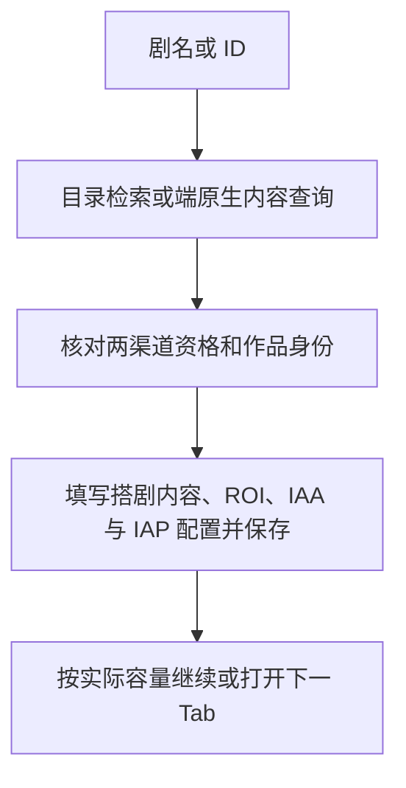

# R3 Web API 自动化搭建系统

R3 通过常读端原生 OpenAPI 解析作品 ID、核验免费与付费渠道资格，再通过浏览器填写一站式搭剧任务及 IAA/IAP 配置。剧名检索使用常读免费漫剧列表页。


## 环境与启动

双击根目录的 **[R3-Web.exe](R3-Web.exe)** 启动桌面控制台。调试浏览器、配置、开始与停止均在软件内操作。

`.exe` 是桌面启动器，请保留同目录的 `src/`、`node/`、`node_modules/`、`package.json`、`pnpm-lock.yaml` 和运行数据；不能只复制单个 EXE。首次准备开发环境时执行 `pnpm install`。项目使用 Node.js 24+，随附运行时位于 `node/node.exe`。

`R3-Web.exe` 直接拉起内置 `node/node.exe` 启动本地 HTTP/SSE 服务（`src/web/main.ts`），默认绑定 `127.0.0.1:3000` 并自动打开浏览器控制台。进程环境变量 `PORT` 可指定起始端口，占用时最多尝试 10 个端口；关闭服务窗口或收到退出信号时请求停止并等待在途任务收尾。

维护命令：`pnpm test` 运行测试，`pnpm run typecheck` 检查类型，`pnpm run build:ui` 更新前端发布资源，`pnpm run build:exe` 使用 Windows 内置 C# 编译器重建启动器。

### 磁盘占用优化（Windows / NTFS）

`pnpm run size:check` 查看依赖及实际存储大小；`pnpm run size:optimize` 并使用 Windows 原生 NTFS 压缩降低 `node/`、`node_modules/` 的磁盘占用。脚本逐文件验证压缩前后的 SHA-256，保留所有运行、构建和测试依赖，不处理业务数据、配置、日志及源码。建议退出软件并停止依赖安装后执行。

`pnpm run size:restore` 可解除这两个目录的压缩，缓存无需恢复。压缩由 Windows 透明读取，会增加少量解压 CPU 开销；资源管理器中的“大小”不因压缩变化，请查看“占用空间”。复制到不支持压缩的磁盘、重新安装依赖或打包 ZIP 后需重新评估实际占用。此命令优化本地磁盘占用，不裁剪发布包功能。

结果表格使用虚拟滚动，日志按 100ms 批量追加。

### OpenAPI 配置

在项目根目录按 [.env.example](.env.example) 创建 `.env`：

```dotenv
CHANGDU_OPENAPI_SECRET_KEY=你的密钥
CHANGDU_OPENAPI_FREE_DISTRIBUTOR_ID=免费渠道ID
CHANGDU_OPENAPI_PAID_DISTRIBUTOR_ID=付费渠道ID
```

进程环境变量优先于 `.env`，修改凭据后需重启。未配置时解析器返回失败。不要提交密钥和业务记录。

### 浏览器与输入

自动化连接 CDP **9224**。软件内的浏览器启动按钮使用独立数据目录 `%LOCALAPPDATA%\EdgeDebug9224`；请在调试实例中登录所需平台。会话有效期取决于平台。

- 完整搭剧自动化始终需要已登录的搭剧复制任务页。
- 输入含剧名时还需要常读免费漫剧列表页；纯 ID 输入通过 OpenAPI 识别。
- 每行可输入剧名、漫剧 ID、抖音作品 ID 或无前缀数字。推荐标明 `漫剧ID：…` 或 `抖音作品ID：…`，多版本结果不自动猜选。

控制台支持输入导入、去重、保存，复制链接配置、面板类别和 ROI 设置，以及停止、重试失败项、日志和 CSV 导出。面板类别为超超小额、超小额、小额、中额。

## 当前业务流程



缓存也必须通过当前两渠道资格和作品身份校验。搭剧 IAA 配置选择默认应用、主管账号、填写名称词包并选择第二个起始解锁选项；IAP 配置选择默认应用、主管账号、填写名称词包及目标充值模板。

剧名候选中，确定的作品资格失败可继续下一候选；鉴权或分页异常停止当前输入的解析。常读解析失败保留槽位，由下一部递补；搭剧内容名称或商品选择连续三轮失败且已确认取消并放弃修改后，该剧移至本次待搭队列末尾，当前槽位立即由下一部递补。每部剧最多延期一次；队尾重试仍失败则记录该剧失败，商品选择耗尽的失败原因为“商品库选择失败”，避免无限循环。未能确认放弃修改、填单结果不确定和其他阻塞失败仍保留页面收尾保护。

输入耗尽时，若当前页没有已填写结果、待处理冲突或不确定的填单结果，正常结束并保留复制模板；“没有可用候选”等单条失败仍显示在失败统计中，不再额外报程序运行异常。这也适用于前页已提交、末页输入全部解析失败，或选择失败已确认放弃修改的情况。填单结果不确定时，仍保留阻塞校验。

搭剧页按实际可用子任务容量分批，配置上限 10，不能固定视为每页 10 个。每页搭满后自动点击“确认提交”，通过整页 upsert 接口的业务响应确认结果，成功后才按复制链接列表轮询打开下一 Tab。末页不足容量时，先移除末尾未使用的复制配置，再提交已搭剧目。

若返回“剧目+抖音号已被其它任务创建过项目”，仅提取本次响应 `msg` 实际展示的重复剧 ID，去重后定位本页对应槽位，将这些原剧目标记失败，使用后续待搭剧按槽位顺序递补。待搭剧用尽后，从后向前删除剩余已展示冲突的子任务；本轮展示的冲突处理完才重新提交。未展示的剧目保持不动，后续提交返回新的重复剧时再处理。。删除后无可提交剧目时停止，不提交空任务。网络超时、未知业务错误或冲突 ID 无法匹配本页时停止，不自动重发。

流水线仅在当前槽位保存完成且本页尚未搭满时预解析下一项；满页时先处理提交结果。预解析仅查询作品身份和资格。

## 运行锁与停止

- runner 通过单实例锁串行运行。释放时核对 PID 和唯一令牌；有效锁、损坏锁和遗留获取目录均阻断新运行。
- 内容查询共享接口限流队列，最小请求间隔为 1000ms。临时故障最多请求 3 次，限流最多请求 4 次；鉴权错误不重试。
- 停止信号贯通流水线、解析器、请求队列、退避和 fetch。`drain()` 等待在途解析收尾，runner 再释放锁，控制台才允许重启。
- 已确认提交的页面不会在本次运行中重提；未知提交结果阻断当前运行，需人工核对平台。

## 目录与运行数据

| 目录或文件 | 用途 |
| --- | --- |
| [src/runner.ts](src/runner.ts) | 自动化编排 |
| [src/coordinator/](src/coordinator/) | 作品解析、资格核验和流水线 |
| [src/platform/](src/platform/) | 常读目录与 OpenAPI、CDP、搭剧填单和网络响应 |
| [src/core/](src/core/) | 配置、路径、ID 解析、缓存、运行锁、冲突保护和日志 |
| [src/infra/](src/infra/) | 定位器、字段映射、状态机和性能分析基础设施 |
| [src/web/](src/web/) | HTTP/SSE 控制台服务、启动入口和前端 |
| [tests/](tests/) | 单元与集成测试，统一入口 `tests/run_all_tests.ts` |
| [tools/](tools/) | 桌面启动器构建和隔离复审脚本 |

运行数据默认在 `data/`，进程环境变量 `R3_DATA_DIR` 可更改数据根目录：

| 文件 | 内容 |
| --- | --- |
| `drama_list.txt` | 剧名或 ID，每行一项（兼容旧版 `搭链接.txt`） |
| `full_flow_unified.run.lock` | 单实例锁 |
| `.full_flow_success.json` | 成功标记 |
| `logs/` | 按运行 ID 分隔的 JSONL、文本日志和性能报告 |
| `r3_state.sqlite` | 事务配置、运行账本与待核对操作；不用于续跑 |

每次执行生成独立 `runId`，服务进程另有 `processSessionId`。日志、事件、性能报告、页提交记录按 runId 关联；缓存与指标按次隔离。控制台结果采用带序号的增量 SSE，同步缺口时重新读取快照，慢连接使用有界队列。结果状态区分等待、运行、已填写待提交、提交中、已提交、失败和结果不确定；仅整页响应确认成功才计入成功数，结果不确定的条目不进入“重试失败项”。

搭剧子任务保存失败时，文本错误日志包含实际页面提示、字段名称和保存接口状态；同次运行的 JSONL 中可搜索 `STAGE_SAVE_FAILURE`，查看子任务序号、作品 ID、保存前后的可见错误、字段控件标识、接口 HTTP 状态、业务码、返回消息及断网/超时状态。`existedBeforeSubmit` 表示该提示在点击保存前已存在，用于排查旧提示干扰；无匹配请求时明确记录未观察到保存请求。诊断不记录表单值、请求正文、请求头或 URL 查询参数，保存结果不确定时仍停止递补与提交。

首次保存后，数据库配置是读取依据，TXT/XLSX 作为兼容导出保留，修改配置请在桌面控制台保存。历史运行与待核对操作可以在界面查询；重启不续跑旧任务，也不自动重发不确定操作。后台致命故障会拒绝新运行并尽量排空后退出。

## 验证与工具边界

构建采用仅保留最新版本的策略：`pnpm run build:ui` 和 `pnpm run build:exe` 会清空并重建 `src/web/public/`，删除历史哈希资源与旧版静态文件。该目录仅用于构建产物，不应存放手工维护文件。构建生成 Vite 资源映射和根目录 `release-manifest.json`，记录当前源码、资源、启动器、Node 与依赖锁文件（`pnpm-lock.yaml`）的 SHA-256 校验值及统一版本指纹。清单不包含业务 data；本地不保留旧版本或回滚副本，需要回滚时使用外部完整发布包备份。

2026-10-01 P1/P2 架构升级后：**232 项测试全部通过，类型检查和前端构建通过**；覆盖增量 SSE、慢连接、崩溃审计和发布前端状态恢复，全部模拟业务操作。

2026-09-26 第一批升级后的代码验证：**145 项测试通过、0 失败，类型检查通过**。数量以实际输出为准。统一测试入口使用临时数据目录；单测也须隔离 `R3_DATA_DIR`，模拟外部操作，避免修改业务数据。

- [tools/review_changdu_api.ts](tools/review_changdu_api.ts)：隔离验证作品查询、两渠道资格核验与长 ID 精度，全部 HTTP 模拟。

端原生授权目前确认 `2` 为无授权、`4` 为普通授权，仅放行 `4`；未知值保守阻断。

## 参数校验

启动与配置保存使用 Zod 运行时校验：输入必须为非空字符串列表（长 ID 不接收数字），复制链接须为 `https://usergrowth.com.cn/onestop/ad/ad_create/copy` 页面，ROI 须为有限正十进制数，面板须为四种支持类别之一。非法 JSON、未知参数及已删除的续搭参数返回 HTTP 400；配置先整体校验再写入。OpenAPI 在无损 JSON 解码后校验响应结构和分页标记，保留既有资格与作品身份检查。

## 故障处理

| 现象 | 处理 |
| --- | --- |
| CDP 9224 连接失败 | 启动调试浏览器，确认所需页面已登录 |
| 未发布、不可投或授权未知 | 核对该版本在两个渠道的状态；未知枚举不猜测放行 |
| 两渠道作品 ID 不一致 | 核对 book_id 和两个渠道返回的 playlet_id |
| 分页重复、提前结束或截断 | 核实完整作品查询结果后再运行 |
| 另一个实例仍在运行 | 等待其收尾，不删除有效锁 |
| 运行锁损坏或遗留 `.acquire` 目录 | 先退出所有实例并核对平台结果，再由维护人员处理；程序不会按文件年龄自动抢锁 |
| 搭剧阻塞或任务中止 | 核对平台已完成内容，整理剩余输入后启动新任务；不支持断点续搭 |
