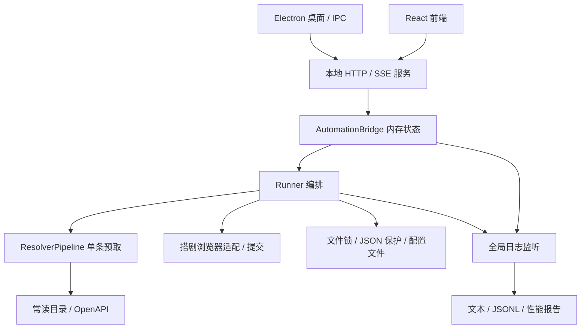
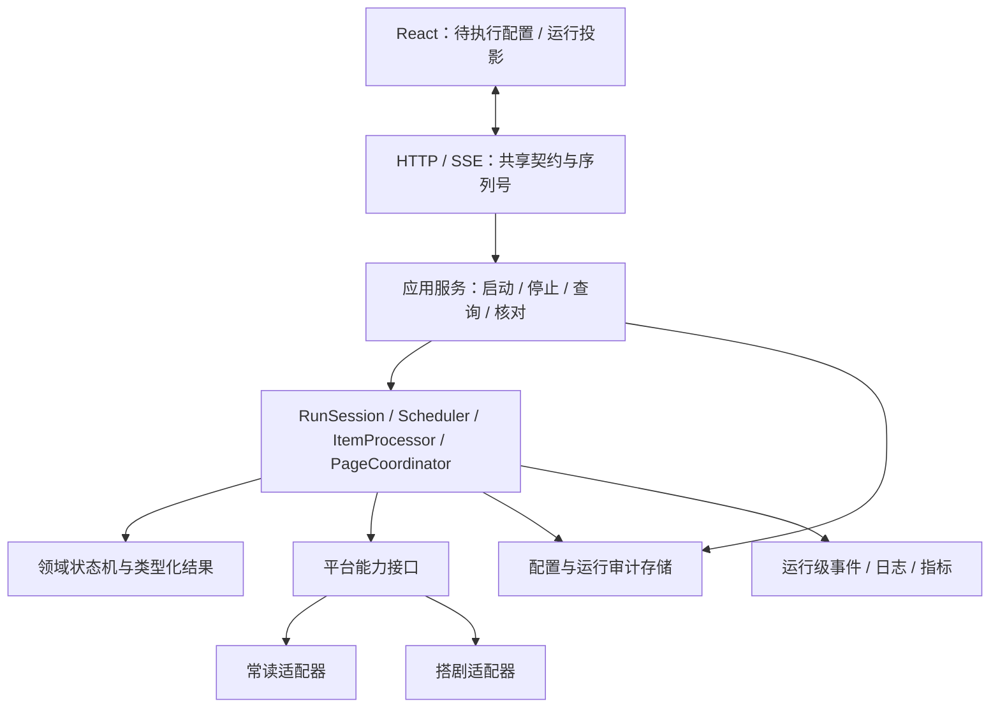

# 系统架构审查与升级建议（2026-10-01）

> 以下保留升级前的审查证据。P1 / P2 的实施与验证结果见 [架构升级说明](architecture_upgrade_20261001.md)。

## 总体判断

推荐继续采用 Electron + 本地 Node 服务的模块化单体架构。现有桌面 IPC、输入校验、平台适配、运行锁、不确定结果阻断和模拟测试是可保留的基础。下一轮重点是运行状态的一致性、增量通信、持久化审计与故障边界。

本次为源码架构审查，没有修改业务实现或执行真实平台业务。上一轮验证为 219 项测试通过；该结果证明已有行为覆盖，不代表已经完成崩溃恢复、SSE 慢客户端或长时间运行的压力验证。

## 当前架构

职责分层存在，但跨层共享状态仍多。Runner 维护排队、页状态、已填槽位和统计；Bridge 从回调维护另一份任务状态；前端又从多个事件和快照维护显示状态。最近的拆分和虚拟滚动分别降低了文件复杂度与 DOM 规模，尚未消除这些同步成本。

## 升级建议（按优先顺序）

### 1. P1：把全量状态推送改为带版本的增量协议

证据：`automation_bridge.ts:107` 的 `getState()` 克隆全部 items；任务开始、填写、成功、失败等回调均推送完整 `state_change`，成功/失败统计还遍历整份 items。`server.ts:168` 对每次事件序列化并直接写 SSE，没有处理 `res.write()` 的背压反馈。

影响：N 条任务产生与 N 同阶的任务事件，每次又处理 N 条记录，相关克隆、序列化和传输工作有 O(N²) 趋势。前端只渲染 27 行不会减少此成本。慢客户端还可能导致发送缓冲持续增长。

建议：

- 初始化或状态缺口时发送快照；正常发送 `item_changed`、`progress_changed`、`page_changed`、`phase_changed`、`logs_appended`。
- 每个事件携带 `protocolVersion / runId / seq`。重复 seq 忽略，发现缺口重新获取快照。
- 任务按 itemId 建索引，统计随合法状态转换更新，不在每次回调中全量扫描。
- 合并高频进度与日志通知；对每个 SSE 连接设置有界发送队列。慢客户端超过阈值时断开并要求重新同步，不能无限积压，也不能悄悄丢掉任务事件。
- 处理 `write()` 返回 false 和 `drain`。Node 的接口文档明确说明 false 表示数据进入用户态缓冲。[Node HTTP 文档](https://nodejs.org/api/http.html#responsewritechunk-encoding-callback)

验收：对 1000、2000、10000 条模拟任务记录总序列化字节、事件数和 UI 更新延迟；正常任务更新包大小不随任务总数线性增加。增加重复事件、缺口、重连和慢客户端测试。

### 2. P1：建立统一任务模型与状态转换入口

证据：任务类型分别定义在 `core/task_state.ts`、`web/automation_bridge.ts`、`web/client/src/types.ts`。后端有合法转换表，前端事件处理仍直接修改 status；`EventSubscriber` 与预取结果使用 any。

建议：新增 `src/contracts/` 定义版本化请求、响应和事件 Schema；后端通过领域状态转换生成事件，Bridge 仅负责查询投影与传输，前端按已确认版本更新投影。域模型与 DTO 可以不同，但必须明确映射。

使用判别联合表达解析结果与错误：`usable / unavailable / retryable / cancelled / uncertain / fatal`，而不是依赖字符串消息决定是否重试。BookId、PlayletId、模板和 SlotId 使用不同的类型边界，底层仍保存字符串。

验收：未知事件、非法状态转换和错误版本可检测；取消及不确定结果不会被映射成普通可重跑失败。共享契约覆盖真实服务与发布前端，而非只在一端通过类型检查。

### 3. P1：补齐崩溃后的审计与结果核对能力

证据：Bridge 任务状态只保存在内存中；保护文件与结构化日志有持久化，但未组成可查询的运行账本。`config_store.ts` 支持请求内回滚，但进程在多个 rename 之间被终止时，不会执行 catch/finally，也没有启动恢复清单。

建议：先把配置收敛为带版本的单一权威配置；TXT/XLSX 保留为导入导出格式。随后为 Run、Item、PageSubmission、PaidCreationAttempt 和事件建立事务存储，SQLite 可作为本地候选。事务能改善本地数据的原子提交和崩溃恢复，仍依赖正确的文件系统与持久化配置。[SQLite 原子提交说明](https://www.sqlite.org/atomiccommit.html)

关键边界：本地事务不能把远程 POST 变成恰好执行一次。必须继续记录 intent，查询远程结果，保留 uncertain 和付费保护；不能以数据库迁移为理由自动重发。

严格保留“每次执行从当前输入开始”的规则。运行账本用于历史展示、核对和人工确认，不恢复已移除的 checkpoint，也不自动继续旧槽位。启动时检测未结束的历史运行并标记待核对。

验收：注入配置替换中途退出、整页提交响应未到等故障；重启后能展示不确定操作，禁止静默重发；ID 和保护记录迁移前后保持一致。

### 4. P1：统一致命故障与服务健康边界

证据：`core/logger.ts:430` 的未捕获异常处理主要记录日志；没有统一设置服务故障状态、拒绝新任务或触发受控退出。

建议：定义 ServiceHealth 与 RunHealth。普通业务失败进入任务状态机；未捕获异常进入 faulted，阻止新启动，记录正在发生的外部操作，并尽可能排空后受控退出。退出等待超过边界时保留不确定记录，而不是清空保护或假定失败。

Desktop 负责展示后端健康与退出原因。若后续实测同步 I/O、浏览器操作或异常持续影响 HTTP 响应，可增加单独的执行进程，由 IPC 承载命令和领域事件；执行进程退出后仍不得自动重发未确认操作。

验收：后台异常后不能继续接受新搭建；界面明确区分“任务业务失败”和“后台服务故障”；操作保护与运行锁的释放顺序可验证。

### 5. P2：拆分 Runner，并引入明确的运行上下文

证据：`runner.ts` 当前 962 行，同时维护 pendingItems、filledTasks、stageStates、冲突替换、页提交和生命周期。缓存、profiler、保护对象与日志监听多为模块级实例。

建议把 Runner 收敛为以下协作对象：

- RunSession：运行 ID、配置快照、取消、资源与锁生命周期。
- QueueScheduler：输入去重策略、延期预算、限流重排与调度。
- ItemProcessor：解析 → 填写 → 核验，返回类型化结果。
- PageCoordinator：当前槽位、冲突替换、裁剪和整页提交。
- ResultProjector：从领域事件生成统计和界面状态。

Page 与 Slot 使用明确状态表达 draft、filled、submitting、submitted、uncertain，而非不断增加页面布尔标志。运行级缓存、计时和事件归属放在 RunContext；账号限流器、凭据提供器等有意跨运行共享的资源由 HostServices 管理。

保留现有依赖注入入口与旧导出，逐个迁移。先迁移纯排队与状态逻辑，再迁移资源生命周期，最后替换 Runner。

验收：每个组件单独测试取消、延期和冲突；连续运行不共享任务状态或运行指标；领域层不依赖 HTTP、React 或具体 Playwright Locator。

### 6. P2：平台适配采用能力接口和契约测试

现有 OpenAPI/浏览器模块隔离已有基础，但 pipeline 和平台边界仍大量使用 any，DOM 变化与业务策略容易耦合。

建议定义 CatalogPort、BookEligibilityPort、StagePort；隐藏 Locator、页面拓扑和平台原始响应。能力接口分别表示查询作品、核验资格、填单、核验、提交和查询结果。支持 AbortSignal 的取消规则与“发送后必须等结果”的例外在接口上写清楚。

维护脱敏响应与 DOM fixture，覆盖接口字段缺失、长 ID、授权变化、面板禁用、选择歧义和业务失败。记录适配器版本，失败时保留请求关联、截图/DOM 摘要及选择证据。

调度优化先保留单个浏览器写入通道。只读 API 可以在限流预算内并行；槽位修改采用保守串行规则。预取仅核验作品身份和资格，保持单条预取及有界队列。

### 7. P2：建立业务级可观测性和统一运行标识

证据：`structured_log.ts:9` 的 RUN_ID 按模块加载生成，同一后端进程的多次执行共享该标识；性能报告另拼时间后缀。前端流水线仍通过日志中的中文关键词判断步骤，已有 onItemPhase 类型尚未贯穿完整链路。

建议分开 processSessionId 与每次启动生成的 runId，并统一传入日志、事件、性能报告、提交记录。步骤由结构化 phase 事件驱动，日志文案只负责可读展示。

观测：每阶段耗时、API 排队/重试、资格失败、缓存命中、浏览器等待、提交不确定、SSE 队列长度、事件循环延迟。常规日志可缓冲写入，关键提交意图和结果记录保持持久化保证。增加日志保留与磁盘容量策略。

验收：单个 runId 可以关联完整链路；改变中文日志文案不会改变前端步骤；日志写入失败时服务健康能体现可观测性降级。

### 8. P3：发布与测试制度化

证据：Vite 使用 `emptyOutDir:false`，public/assets 已累积多个历史构建；源码、前端资源、Node 与 EXE 随目录分发，缺少统一发布清单。

建议在独立临时目录构建发布包，生成应用版本、前端构建版本、协议版本和内容哈希清单，整体切换并保留上一份可回滚包。将业务 data 与发布产物分离，更新不得覆盖凭据和保护记录。明确保留资产列表，清理无入口引用的旧 bundle。

建立四类验证：领域单元测试、平台契约 fixture、真实发布前端 E2E、进程级故障注入。性能测试增加可重复的字节量和内存指标，而不只检查可见 DOM 数量。

## 推荐目标结构

## 实施顺序

1. 共享契约、统一 runId、领域事件和增量 SSE：首先降低大批量成本，并稳定后续迁移接口。
2. 单一配置、运行审计、故障状态和核对流程：改善崩溃后的可解释性与操作安全。
3. Runner 拆分、RunContext 与平台能力接口：逐步迁移，每步保留当前回归测试。
4. 发布清单、性能基线与故障注入常态化；依据实测决定是否拆出执行进程。

最终约束：保留 EXE 入口、单实例锁、长 ID 字符串、两渠道作品资格核验、取消排空和不确定结果阻断；运行账本不用于自动续跑旧 checkpoint。升级的主要收益应是减少整表同步、统一状态依据、明确故障结果，而不只是继续拆分文件。
