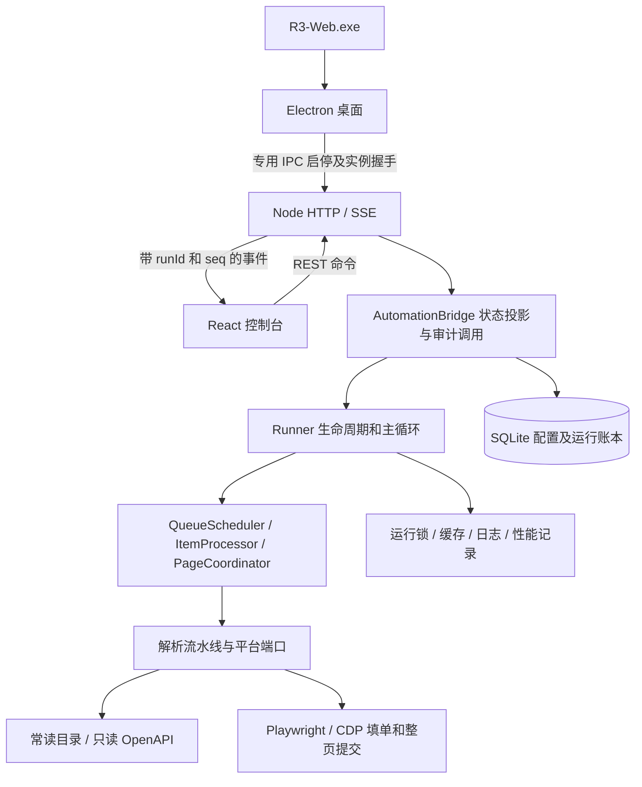

# 项目架构评估报告（2026-10-15）

评估对象：当前工作区源码、桌面启动链路、前后端协议、持久化与统一测试入口。结论基于本次源码审查、210 项测试和隔离模拟验证；未执行真实平台任务，未修改业务实现。

## 1. 总体结论

**继续采用 Electron + 本地 Node 服务的模块化单体架构是合理选择。当前优先事项是补齐配置传递和审计一致性，而非更换框架或拆成微服务。**

项目已经从脚本集合演进为具有桌面生命周期、任务状态机、平台适配、事务账本和增量通信的应用。运行锁、不确定提交阻断、长 ID 保真及模拟测试是较扎实的基础。2026-10-01 旧报告中提出的增量 SSE、按运行隔离和 SQLite 审计已落地，不应再次作为“尚未实现”的问题。

主要短板在模块之间的衔接：输入契约接受的参数可能被中间层丢弃；恢复逻辑没有验证运行归属；整页提交在数据库里仍按单条回调分别落账；部分浏览器写操作缺少对应的操作意图记录。正常路径覆盖较好，跨进程和崩溃窗口的证据还不完整。

| 维度 | 评估 | 主要依据 |
| --- | --- | --- |
| 架构与业务匹配 | 良好 | 单机、登录态浏览器、串行写入，适合本地模块化单体 |
| 模块边界 | 中等 | 已拆出协调器与端口，但 Runner、Bridge 仍承担较多职责，契约反向依赖实现类型 |
| 业务操作保护 | 较好 | 独占锁、当前槽位校验、提交响应确认、未知结果停止重发 |
| 数据与状态一致性 | 需优先改进 | 整页成功不原子、恢复无归属检查、填单意图未完整入账 |
| 前端与通信 | 较好 | 共享事件校验、序号、缺口快照恢复、批处理、虚拟滚动与背压 |
| 可测试性 | 较好 | 平台依赖可注入，单元、集成与 DOM 测试覆盖关键行为 |
| 长期维护与交付 | 中等 | 有发布指纹；数据库演进、保留策略、契约测试和文档仍需完善 |

上述为定性评估，不是生产可用性认证或覆盖率评分。

## 2. 当前架构与职责

- **桌面层**：C# 启动器拉起 Electron；Electron 通过子进程 IPC 识别后端实例、PID 和实际端口，退出时等待后端收尾。
- **接口与展示层**：原生 HTTP 提供 API 和静态资源；React 通过 SSE 接收状态。当前界面源代码位于 `src/web/client/`，`src/web/public/` 是发布产物。
- **应用编排层**：Runner 管理浏览器、运行锁、队列推进、页容量、填单、递补和收尾。协调器已经提取部分职责，但 Runner 仍保存大量可变上下文。
- **平台层**：常读接口负责内容查询和资格核验；平台写入通过浏览器进行，保存与整页提交分别确认结果。
- **基础设施层**：SQLite 保存配置和历史审计；AsyncLocalStorage 隔离按次资源；文件锁保护浏览器业务写入；日志和性能文件提供诊断。

这里应保持“单个业务写入运行 + 有界只读预取”的并发模型。浏览器页面是共享且有副作用的资源，扩大填单并发需要新的资源隔离设计。

## 3. 发现与优先级

优先级定义：P1 为影响业务配置或审计可信度、应优先修复的问题；P2 为维护性、性能或长期运行风险。此次没有确认必须立即停用的 P0 问题。

### F1 · P1：充值模板参数通过校验后被丢弃

**状态：已隔离复现。**

`startRequestSchema` 和 `configRequestSchema` 接受 `paidTemplate`，但 HTTP `/api/start` 只转发关键词、复制链接和 ROI；Bridge 的启动参数及调用 Runner 的配置也遗漏模板。配置 GET 同样没有返回该字段。Runner 最终可以回退到固定的“超超小额”。

证据：

- [输入契约](../src/core/validation.ts#L20)
- [HTTP 启动参数转发](../src/web/server.ts#L307)
- [Bridge 启动及 Runner 调用](../src/web/automation_bridge.ts#L175)
- [默认模板](../src/core/config.ts#L23)

复现：向 Bridge 传入 `paidTemplate: '小额'`，注入的模拟 Runner 实际收到 `undefined`。现有接口测试验证保存返回 200，但没有验证该参数最终进入执行配置。

**影响**：调用方得到成功响应，却可能按默认充值模板执行；配置、运行快照和实际执行不一致。

**建议**：建立一个完整的执行配置类型，贯通保存、读取、启动校验、Bridge、审计快照和 Runner；明确保存值、显式启动值及默认值的优先顺序。补充从 HTTP 请求到模拟填单端口的参数贯通测试。

### F2 · P1：启动恢复未区分其他实例仍在运行的任务

**状态：恢复行为已隔离复现，多实例启动入口缺少互斥经源码确认。**

`getAuditStore()` 首次初始化即执行 `recoverInterrupted()`，后者把全部 `running` 运行改为 `needs_review`，把全部 `intent/submitting` 操作改为 `uncertain`，没有检查运行所有者或存活状态。Runner 的文件锁只在实际启动运行时获取，不能保护后端初始化期间的恢复。Electron 主程序和 C# 启动器没有显式的应用单实例互斥。

证据：[恢复 SQL](../src/core/audit_store.ts#L30)、[数据库初始化](../src/core/audit_store.ts#L75)、[Runner 获取锁](../src/runner.ts#L170)、[桌面入口](../src/desktop/main.js)、[启动器](../tools/launcher/ElectronLauncher.cs)。

复现：同一临时数据库保留一个当前存活进程创建的 `running` 运行，再用第二个独立数据库连接执行启动恢复；原运行立即变为 `needs_review`，操作变为 `uncertain`。这是数据库边界复现，未实际拉起第二个 Electron 窗口。

**影响**：打开第二个实例可能误改第一个实例的历史状态；即使后续 Runner 被锁拦住，审计状态也已经改变。

**建议**：应用级实例互斥应先于后端数据库初始化；恢复还应校验运行所有者及进程身份，或在独占维护锁内执行。不得仅凭时间长短认定运行已经中断。增加“实例 A 活跃，实例 B 启动，A 的账本保持不变”的进程级测试。

### F3 · P1：整页成功与条目状态没有在同一事务中落账

**状态：非原子中间状态已隔离复现。**

平台返回整页成功后，`PageCoordinator` 逐个触发 `onItemSuccess`。Bridge 对每个条目先单独写页操作 `success`，再通过另一事务写条目补丁；整页所有条目没有共同的完成事务。

证据：[整页成功分发](../src/coordinator/page_coordinator.ts#L51)、[Bridge 成功回调](../src/web/automation_bridge.ts#L335)、[独立操作事务](../src/core/audit_store.ts#L58)、[独立事件事务](../src/core/audit_store.ts#L50)。

复现：模拟两条目整页成功，在第一条成功回调后读取数据库，页操作已经是 `success`，两条目分别为 `success` 和 `submitting`。

**影响**：若进程在逐条回调期间退出，历史记录可能长期呈现“页成功、部分条目提交中”。当前恢复不会把已成功页对应的条目统一投影为成功，审计页面也不能自动解释这一差异。

**建议**：以整页响应作为持久化提交单元，在一个事务内更新页操作、该页所有有效条目、计数和对应事件，再向前端发送增量。保留本次冲突范围约束。增加“平台确认成功后、落账过程中退出”的故障注入测试。

### F4 · P1：填单与删除操作缺少完整的持久化意图

**状态：源码确认；未执行真实崩溃后的平台核对。**

运行账本目前主要由 Bridge 在整页提交状态及成功回调中写入 `operations`。Runner 执行子任务填单前只在内存设置 `fillUncertain`，作品身份在成功后的 `onItemFilled` 才进入条目投影；删除未使用配置和冲突槽位也没有对应的操作意图记录。

证据：[填单前状态及平台调用](../src/runner.ts#L508)、[填写完成回调](../src/runner.ts#L565)、[删除操作](../src/platform/stage_submit.ts#L28)、[当前操作落账位置](../src/web/automation_bridge.ts#L324)。

**影响**：子任务保存已发出但进程突然退出时，历史记录可以说明运行中断，却可能缺少当时的作品 ID、目标槽位及具体写操作。JSONL 有部分线索，但与数据库不在同一事务内，也不直接形成历史核对清单。

**建议**：在填单保存、槽位删除等外部写操作之前落账 `intent`，记录 runId、操作标识、作品身份、页和槽位；确认后写结果。崩溃后的未决意图只供人工核对，继续保持禁止自动续跑和自动重发。

### F5 · P2：分层已经建立，依赖方向和类型边界仍不完整

**状态：源码确认。**

- `contracts/platform.ts` 从平台实现导入提交结果及 OpenAPI 函数类型，契约会随实现签名变化。
- `PageCoordinator` 导入 Runner 的选项类型，而 Runner 又依赖该协调器，形成编排层与下层之间的双向类型依赖。
- `ResolverResult` 将成功分支的数据字段定义为可选；即便 `ok: true`，编译器也不能保证 ID 和名称已经具备。
- 平台页面仍大量使用 `any`，端口的 `unknown` 并未形成贯穿实现的类型约束。
- 前端 `useSSE` 同时保留新事件协议和大量旧事件处理分支；当前服务端 SSE 只发送 `console_event`。

证据：[平台契约](../src/contracts/platform.ts#L1)、[协调器上下文](../src/coordinator/page_coordinator.ts#L1)、[旧协议分支](../src/web/client/src/hooks/useSSE.ts#L147)。

**影响**：修改执行参数或事件时需要同步多个定义；类型检查能够通过，也可能出现 F1 这种字段漏传。双向类型引用本身不等于运行时循环故障，但降低了模块独立演进能力。

**建议**：把平台结果类型、执行配置和应用事件放在独立契约模块；成功解析结果使用必填字段；协调器依赖所需的最小上下文与事件接口。确认无旧协议消费者后移除兼容分支，并增加导入边界检查。避免仅按文件长度机械拆分 Runner。

### F6 · P2：持久化开销和历史体量缺少长期约束

**状态：同步 I/O 和无账本保留策略经源码确认；真实卡顿与增长速率尚未压测。**

SQLite 使用同步数据库、`synchronous=FULL`，每个补丁单独开启写事务；控制台日志还同步追加到运行日志与 `latest.log`。数据库事件、条目和运行配置持续追加，没有可见的归档/清理策略；历史查询只展示最近 100 次，不会减少存储量。

证据：[数据库配置与事务](../src/core/audit_store.ts#L14)、[补丁写账](../src/web/automation_bridge.ts#L142)、[同步日志](../src/core/structured_log.ts#L94)、[历史查询](../src/core/audit_store.ts#L62)。

测试中 10,000 条纯模拟失败路径约耗时 14.4 秒，说明增量协议规模可控，也提示同步持久化成本值得单独测量。该数字包含回调、校验、序列化及数据库写入，不能直接当作真实业务吞吐量或 SQLite 单独耗时。

**建议**：先测事件循环延迟、事务延迟、数据库体积和停止响应，再决定是否使用专用写入线程或合并投影事务。外部写操作的意图必须在实际调用前获得持久化确认，不能为了批处理延后。制定历史归档规则，并优先保留未决操作、失败与人工核对证据。

## 4. 值得保留的设计

1. **安全串行与按次隔离**：运行锁同时核对 PID 和令牌，损坏锁保守阻断；AsyncLocalStorage 隔离缓存与性能资源。取消解析后等待 drain，再释放锁。
2. **提交确认依赖实际响应**：整页提交通过本次请求的业务响应判断结果，超时和未知错误不自动重发；冲突只处理响应实际展示的作品范围。
3. **只读查询与写入分离**：OpenAPI 负责身份与资格，浏览器负责平台表单；长 ID 解码和两个渠道一致性检查均有覆盖。
4. **增量协议和受控展示**：共享 Zod 事件契约、序号检测与快照恢复、慢连接队列上限、前端批处理和虚拟滚动已存在。
5. **可注入外部依赖**：Runner、解析器、HTTP 和浏览器行为可以模拟，测试不需要执行真实平台任务。

## 5. 本次验证与证据边界

| 验证 | 本次结果 |
| --- | --- |
| 运行环境 | 随附 Node v24.16.0 |
| `node/node.exe tests/run_all_tests.ts` | 210 项通过，0 失败、0 跳过，约 79.6 秒 |
| 后端 `tsc --noEmit` | 通过 |
| 前端 `tsc -p src/web/client/tsconfig.json --noEmit` | 通过 |
| 模板参数贯通模拟 | 请求“小额”，模拟 Runner 收到空值，确认 F1 |
| 双连接恢复模拟 | 活跃运行被改成 needs_review，确认 F2 的数据库行为 |
| 两条目整页成功模拟 | 页 success、条目 success/submitting 并存，确认 F3 的非原子窗口 |

验证通过项目自带临时数据隔离入口执行；额外模拟也使用独立临时数据库，完成后清理。未访问真实业务平台、未查看凭据、未执行发布构建。DOM 测试验证的是当前发布前端资源；此次未重新构建，因此不能据此证明发布资源与当前全部前端源码完全一致。

测试数量与 README 所列历史“232 项”不同：该数字明确属于历史升级记录，本次以统一入口实际输出的 210 为准，不能直接推断有 22 项回归丢失；需对照历史版本才能解释差异。

当前未覆盖的证据包括：长时间真实运行、低速磁盘与锁竞争下的响应、整页成功落账中途进程退出、第二个真实桌面实例启动，以及发布包完整性验证。现有崩溃测试会直接写入模拟 intent，尚不能证明真实 Runner 的每个外部写操作都已落入操作账本。

## 6. 建议实施顺序与验收标准

| 顺序 | 工作 | 验收标准 |
| --- | --- | --- |
| 1 | 修复完整配置传递 F1 | 四类模板经 HTTP 保存、读取、启动后，与模拟填单端口及审计快照一致 |
| 2 | 修复恢复归属 F2 | 第二实例无法误标活跃运行；真正中断的运行仍可被标为待核对 |
| 3 | 整页结果原子落账 F3 | 在完成事务各阶段注入退出，重启后不存在已确认成功页与条目状态矛盾 |
| 4 | 补齐外部操作意图 F4 | 填单保存、删除和提交前均有可核对身份的持久化记录；未知结果不重发 |
| 5 | 收紧契约和依赖 F5 | 契约不依赖具体平台实现；成功解析结果字段必填；旧协议分支退出 |
| 6 | 测量并优化长期运行 F6 | 得到事务与事件循环延迟基线，历史存储有明确保留规则且不丢未决证据 |

交付方面还建议补充数据库 schema 版本及迁移测试，明确“后端原生 TypeScript 执行、前端必须构建”的开发说明，并验证发布指纹与实际部署内容的对应关系。现有 `CREATE TABLE IF NOT EXISTS` 能初始化数据库，不能替代未来结构变更所需的迁移流程。

本轮应先完成配置与审计闭环，再继续拆分主循环。验收应以跨层参数一致性、跨进程隔离及崩溃后的可核对性为中心。
