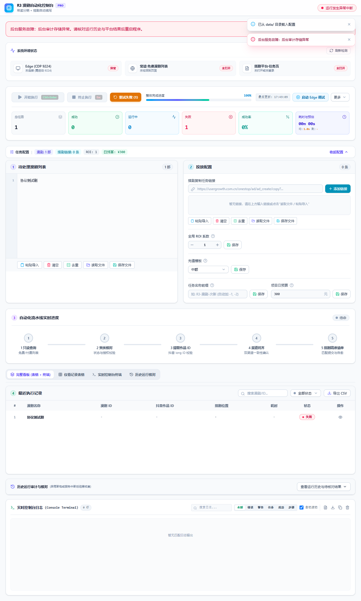

# P1 / P2 架构升级实施说明

本轮完成架构审查中七个 P1 / P2 方向的代码接入，继续使用 Electron 与本地 Node 服务。真实平台操作仍从 `R3-Web.exe` 桌面控制台发起；验证全部模拟外部业务，没有提交真实投放任务。

## 实施对应

| 审查项 | 本轮实现 |
| --- | --- |
| P1 增量通信 | `contracts/console.ts` 定义协议 v1；事件包含 runId、seq 和 kind。初始化、重连或缺口使用快照，正常发送 patch、logs、phase。Bridge 建立条目及页面索引，计数随合法转换更新。服务端和前端日志按 100ms 合并；前端任务增量按 100ms 合并。 |
| P1 共享状态 | 前后端使用相同任务、进度、日志、阶段和健康 Schema；核心状态机拒绝非法转换；ResultProjector 维护投影与计数。未知协议触发重新同步，重复事件忽略，恢复期间收到的事件有界暂存并在快照后重放。 |
| P1 审计与配置 | SQLite WAL / synchronous=FULL 存储配置版本、运行、独立配置快照、任务、事件和操作意图。任务变更、事件与运行头在同一事务写入。付费 guard 保存后持久化操作意图，整页提交前记录 submitting。重启将未结束运行标记 needs_review，未确认意图标记 uncertain。 |
| P1 致命故障 | ServiceHealth 区分 ready / faulted；未捕获异常、拒绝及关键审计写入失败触发故障，取消当前运行并拒绝新运行。桌面后端尽量排空后退出，超时上限 90 秒；保留操作记录。界面显示故障、禁用启动；Electron 接收退出原因。 |
| P2 Runner 分层 | RunSession、QueueScheduler、ItemProcessor、PageCoordinator、ResultProjector 分担运行、排队、解析、整页提交及查询投影。保留原依赖注入入口。PageCoordinator 对 submitting / uncertain 明确禁止再次发送，并保留已知冲突槽位递补规则。 |
| P2 平台边界 | CatalogPort、BookEligibilityPort、ResolverPort、StagePort 接入实际调用；取消和不确定结果保留类型信息，不确定任务提交会阻断后续递补。BookId / PlayletId 在解析边界验证为数字字符串，不转换为 Number。保留单浏览器写通道和单条预取。 |
| P2 运行观测 | 每次启动生成独立 runId，processSessionId 仅标识服务进程；JSONL、文本日志、性能报告、SSE、付费操作和页提交记录使用运行 ID。AsyncLocalStorage 隔离缓存、指标、Profiler 和阶段回调。前端正式协议由结构化 phase 驱动。状态 API 提供进程 RSS、事件循环延迟、SSE 队列、包数、字节数与慢连接断开统计。 |

## 传输与内存边界

- SSE 每个连接的待发队列上限为 1 MiB，单帧上限为 16 MiB。`write(false)` 后等待 drain；超限断开，重连获取完整快照。任务事件不会在连接内被悄悄丢弃。
- 服务端保存最近 500 条日志，前端显示最近 800 条。前端缺口恢复暂存最多 2,000 个事件，超界后的序号缺口继续通过快照恢复。
- 前端任务批次按条目 ID 合并，重复更新保留最新值；到达 10,000 个条目时先提交批次，不能像普通日志缓冲一样丢弃任务更新。阶段及运行结束前强制提交当前批次。
- 正常条目更新不携带全量 items。快照、初始化存储和最终核对允许遍历整个输入集合；每页确认事件可以携带该页变更项。
- 现有结果虚拟滚动继续保持 44px 行高，10,000 条结果仅渲染视口附近行。

## 配置与历史使用

新增 `data/r3_state.sqlite`。首次保存配置前读取原 TXT / XLSX；首次保存时先将旧配置整体写入数据库，再导出兼容文件，最后提交新配置版本。进程在兼容文件更新中途退出时，数据库仍保持旧配置整体，后续读取不会混合使用半更新的文件。

已有数据库配置后，请在桌面控制台修改并保存。单独编辑 TXT / XLSX 不会覆盖数据库中的配置。凭据、冲突保护继续使用现有位置和规则；不从运行账本自动重发请求。备份时先关闭程序，再一起备份整个 data 目录，包含数据库及可能存在的 WAL 文件和保护文件。

界面的“查看运行历史与待核对结果”展示最近 100 次运行，任务按 200 条分页。历史记录用于核对，不能恢复旧任务槽位；每次运行仍从当前输入列表开始。遇到 needs_review / uncertain，先查询平台结果，保留 guard；不能通过删除账本绕过付费保护。

## 回归与性能证据

模拟任务通过真实 Bridge、状态机、SQLite 审计和事件序列化链路：

| 输入数 | 正常增量包数 | 增量字节总量 | 最大增量包 |
| --- | ---: | ---: | ---: |
| 1,000 | 2,002 | 853,343 | 452 B |
| 2,000 | 4,002 | 1,718,343 | 454 B |
| 10,000 | 20,002 | 8,668,354 | 459 B |

字节量为该 fixture 中初始快照以外的所有包，输入名称、时间戳及运行 ID 长度会影响实际数字。这些结果证明该模拟链路的单条更新大小有界、总传输量随条数线性增长；不代表真实平台吞吐量。

新增验证覆盖：SSE drain 与超界释放；异步运行资源隔离；事件版本、序号与状态校验；排队预算；页提交不确定后禁止重复发送；SQLite 事务回滚、长 ID 与重启核对；子进程在兼容配置导出和操作 intent 后异常退出；后台故障拒绝启动；真实发布前端在缺口恢复期间保留新事件、忽略重复事件、展示阶段与故障禁用启动。

最终验证：**232 项测试全部通过，0 失败、0 跳过；类型检查和发布前端构建通过**。原有付费资格、取消排空、锁、冲突替补、商品选择耗尽及浏览器 DOM 回归保留。

## 保留的边界

本地数据库事务不能保证远程 POST 恰好执行一次；uncertain 必须人工核对，不能自动重试。运行账本与关键意图同步持久化，常规投影仍在内存中；历史查询从数据库读取。业务日志和账本保留在本地，本轮没有自动删除历史审计数据，应定期备份和检查磁盘容量。

暂不增加执行子进程、跨设备分布式队列或浏览器多写通道。发布包原子切换、旧 bundle 清理与更新回滚属于原报告 P3，未纳入此次 P1 / P2 范围。
